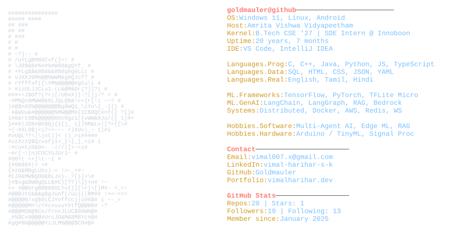

<picture>
  <source media="(prefers-color-scheme: dark)"  srcset="dark_mode.svg">
  <source media="(prefers-color-scheme: light)" srcset="light_mode.svg">
  
</picture>

### Vimal Harihar S K — Software Engineer · AI & ML

B.Tech CSE at Amrita Vishwa Vidyapeetham, Coimbatore. I build multi-agent pipelines, RAG systems and edge-AI models.
Winner, Infineon PSoC 6 Hackathon 2025 · Finalist, Caterpillar Tech Challenge 2026, AWS AI for Bharat 2026, Smart India Hackathon 2025 · IEEE-published.

  <a href="https://www.vimalharihar.dev/" rel="me">Portfolio — vimalharihar.dev</a> &nbsp;·&nbsp;
  <a href="https://www.linkedin.com/in/vimal-harihar-s-k-27979a255/" rel="me">LinkedIn</a> &nbsp;·&nbsp;
  <a href="https://scholar.google.com/citations?user=fFkE2O0AAAAJ" rel="me">Google Scholar</a> &nbsp;·&nbsp;
  <a href="https://orcid.org/0009-0007-5084-4585" rel="me">ORCID</a> &nbsp;·&nbsp;
  <a href="mailto:vimal007.x@gmail.com">Email</a>

